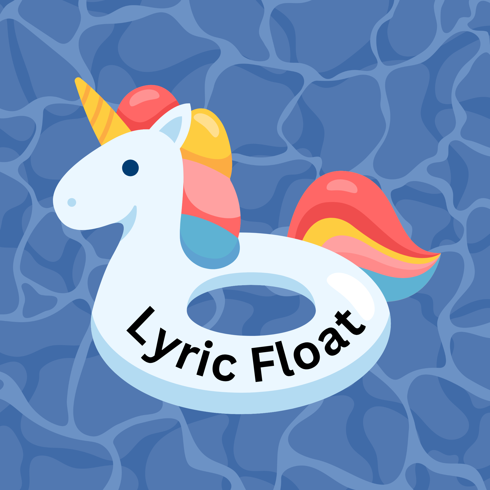
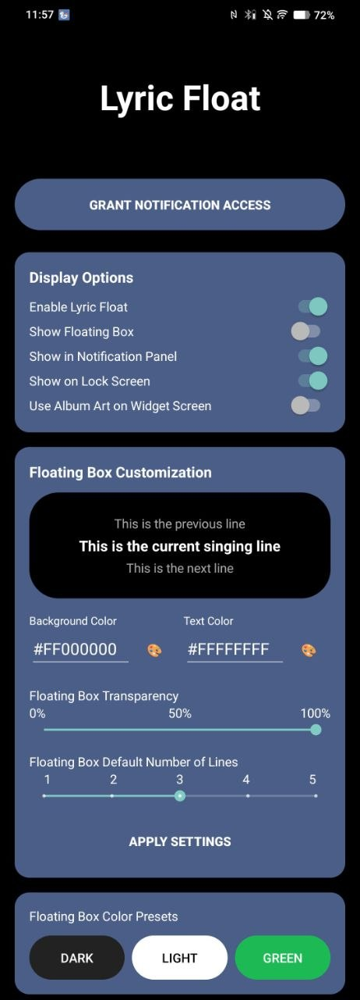
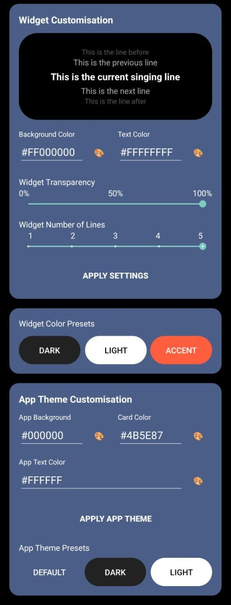
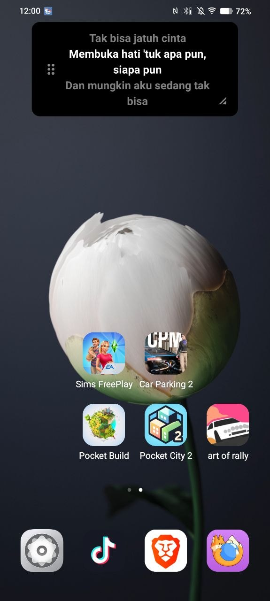
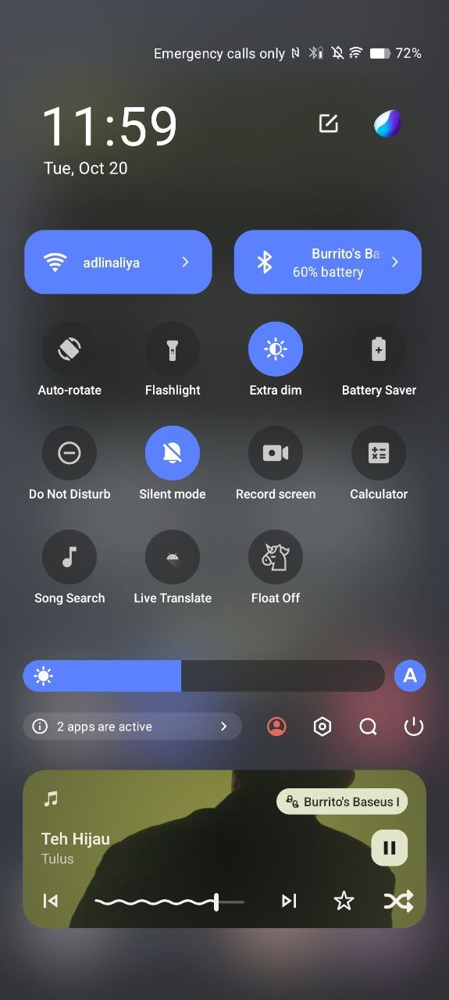

# Lyric FLoat

Lyric Float is a lightweight, customizable Android overlay and home screen widget that delivers time-synced lyrics directly to your screen. Designed with performance and aesthetics in mind, it provides seamless window controls, dynamic theming, and an intelligent offline caching system.

  
  
  
  
  
  
  
  

## Key Features

* **Dynamic Floating Window Controls:** Features a 2x3 dot left-edge drag handle and a bottom-right expand handle for real-time line count adjustments. UI thread performance is protected during active resizing via a dedicated optimization flag.
* **Smart Widget Accent Extraction:** The home screen widget automatically extracts the primary accent color from the currently playing album art (using an efficient 1x1 pixel downscaling algorithm). If no album art is present, it gracefully falls back to a custom user-defined hex color with smooth, rounded edges.
* **Advanced Customization Dashboard:** A dark/slate-blue UI offering independent control over the floating box, home screen widget, and app themes. Includes visual color pickers, tick-mark aligned number sliders, and live previews.
* **Offline Lyric Caching:** A zero-dependency local storage system that caches fetched `.lrc` files for offline playback. Includes an automated, silent cleanup protocol that prunes lyrics unplayed for 30 days to guarantee zero storage bloat.
* **Non-Destructive Quick Settings:** The QS tile exclusively toggles the floating box visibility (Visible / Hidden) without terminating the background service.
* **Native System Integration:** Fully integrated transparent status bar and lock screen notification silhouette, bypassing standard Android 5.0+ icon restrictions.

## Technical Details

* **Language:** Kotlin
* **Architecture:** Coroutines for asynchronous network and file I/O operations, `HttpURLConnection` for zero-dependency API fetching, and `RemoteViews` for widget rendering.
* **APIs:** Integrates with established `.lrc` providers for synchronized lyric fetching and parsing.
